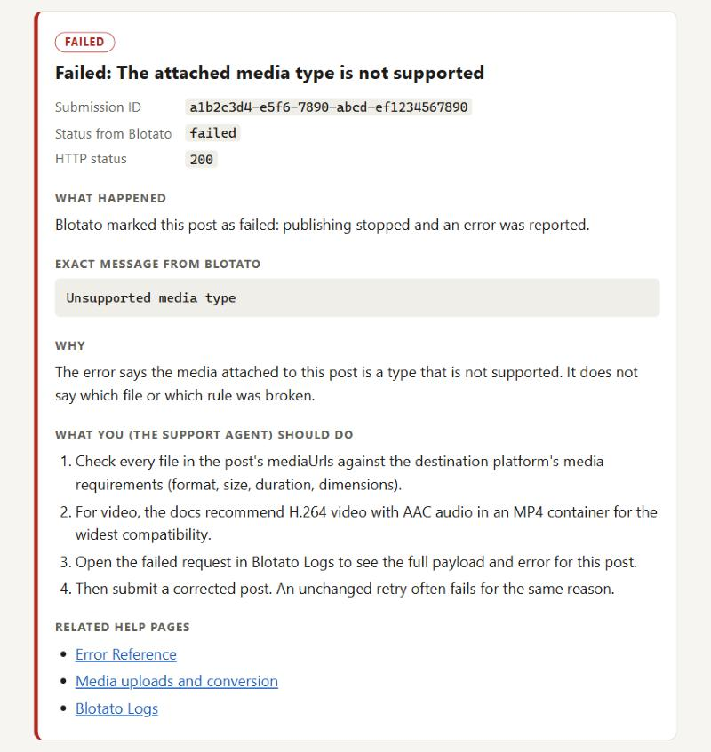
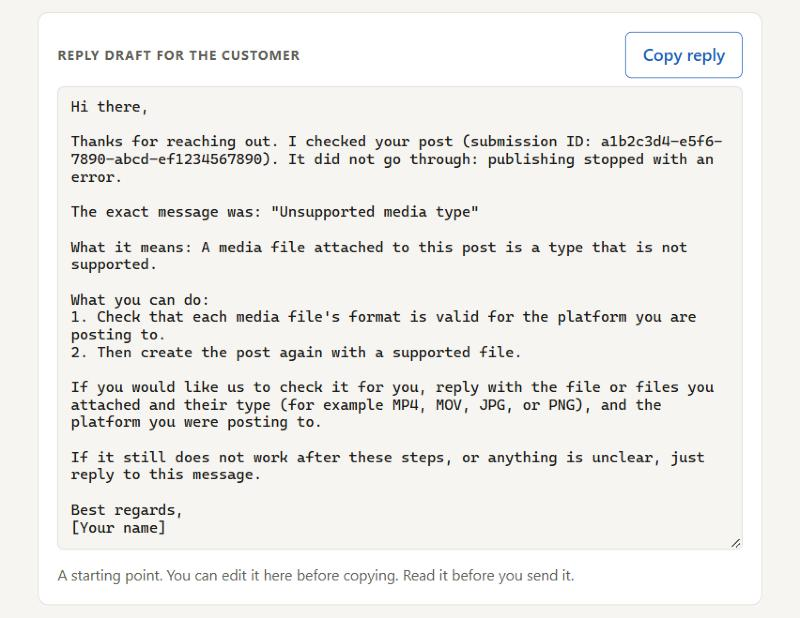

# Blotato Post Doctor

A small local tool for **Blotato support agents**. Paste a post submission ID and it checks the post's status with the Blotato API, then explains in plain language what happened, why (only when the official docs say why), and what to do next.

It produces two things, for two different readers:

- **A card for the support agent**: the status, the exact error from Blotato, the explanation, the agent's next steps, and links to the matching help pages.
- **A reply draft for the customer**: written for the customer, with only the steps the customer can take. The agent edits it and copies it.

Unofficial project. Not affiliated with Blotato. Built for a job application (Customer Support AI Engineer at Blotato).

| Card for the support agent | Reply draft for the customer |
| --- | --- |
|  |  |

Both screenshots show the `failed-unsupported-media` sample, whose response is copied from the Get Post reference.

## Honest status

- **Live mode has not been tested against the real Blotato API.** The API needs a paid Blotato plan, which I don't have yet. Live mode is written from the official docs only. It is tested against a fake Blotato server in the automated tests, which shows how this app behaves, not how the real API answers.
- **Every sample says where it came from.** There are 14 samples, and each has an `origin` label that the page shows next to it:
  - `docs-verbatim` (6): the response body is copied from the docs.
  - `docs-composed` (7): the response shape is from the docs, but the values are combined from other pages (for example an error text from the Error Reference). Nothing here is a captured real response.
  - `invented` (1): made up on purpose, to show what happens with an error the tool does not know.

## Run it

You need [Node.js](https://nodejs.org) 20.12 or newer (built with Node 24). There are no dependencies, so there is nothing to install.

### Sample mode (no API key)

```bash
npm start
```

Open http://localhost:3000, keep **Sample** selected, pick a sample, and click **Check post**.

To read every reply draft the app can produce on one page, open http://localhost:3000/drafts.html.

### Live mode (needs a paid Blotato plan)

1. Copy `.env.example` to `.env` in the project folder.
2. Put your key in it: `BLOTATO_API_KEY=...` (from Settings > API in Blotato). The Blotato docs warn that generating an API key ends a free trial and starts the paid subscription.
3. Run `npm start`. The terminal says whether it found a key.
4. Open http://localhost:3000, choose **Live**, paste the `postSubmissionId` from the original create response, and click **Check post**.

`.env` is in `.gitignore`, so the key is never committed.

### Tests

```bash
npm test
```

## How live mode behaves

These rules come from the Blotato docs:

- **One read-only request per check:** `GET https://backend.blotato.com/v2/posts/:postSubmissionId` with the `blotato-api-key` header. The app never creates, edits, or resubmits a post, and never polls on its own.
- **At least 10 seconds between checks of the same submission ID.** The server enforces this, and the button counts down.
- **The API key stays on the server.** It is read from `.env` and is never sent to the browser. If an error message from Blotato ever contained the key, it would be replaced with `[redacted]`.
- **Live checks only come from this page on this computer.** The server listens on 127.0.0.1 only, and live checks need a request header that only this page sends.
- **Error responses follow the OpenAPI reference.** Bodies for 403, 404, 429, and 500 have `message`, plus optional `code`, `reqId`, `action`, and `details`, and `subscriptionStatus` on a 403. The card shows the request ID and Blotato's suggested action. The customer draft never does.
- **`in-progress` is not treated as proof that the ID is valid.** The docs say the API also returns `in-progress` when no record matches the ID.

## How the reply drafts work

Each diagnosis has `agentSteps` for the card and a separate `customerReply` for the draft. The draft follows these rules:

- **No tool or agent wording.** Nothing about `.env`, HTTP codes, Logs, the Error Reference, "the docs say", or "contact support" (the reply *is* support).
- **No made-up fixes.** For a known error, the customer's steps come only from the official Error Reference. When the official fix is something only support can do, the entry is marked `handledBySupport`, and the draft says support is handling it.
- **No guessed causes.** An error that is not in the catalog is quoted exactly and passed to the technical team. The draft asks the customer not to resubmit, and asks for the platform, media type, and time.
- **A failed check is not a diagnosis.** If the status check itself fails (HTTP error or network error), there is no diagnosis draft. There is only an optional holding reply that names no cause.
- **Every promise gets a reminder.** If a draft says "I have passed the details to our technical team", "We are looking into it", or "We will update you", the agent sees a "Before sending" reminder to actually do it first. No draft promises a response time.
- **Time zones are flagged.** Scheduled times are shown in UTC, and the agent is reminded to convert them.

## How the reply drafts were reviewed

Automated tests (85 in total) guard the rules above for every draft the app can produce: one per sample and one per catalog entry. For example, the tests check:

- no forbidden wording;
- every promise has a reminder;
- at most one numbered list, and never a one-item list;
- no sentence is repeated, even reworded;
- a 24-hour-limit error from an unknown platform gets no list of platform limits.

Tests only catch what someone thought to write a test for, so the drafts were also reviewed by reading them. I read the 14 sample drafts myself. The 75 catalog drafts were reviewed in a separate Claude chat that had not written them, and I decided which findings to fix. The biggest finding, that drafts told customers to do the agent's work, was mine: the first version gave the customer the same steps as the agent, so drafts told customers to open Logs, check the app's `.env` file, and "contact Blotato support". The reviews also caught:

- a draft that asked for the submission ID right after saying "we are looking into it";
- "the docs say" phrasing in customer text;
- defensive wording such as "I do not want to guess";
- sentences that appeared twice in one draft;
- one-item lists.

Each finding was fixed and turned into a test.

## MCP servers I used and why

- **`blotato-docs`** (`https://help.blotato.com/~gitbook/mcp`, configured in `.mcp.json`). It is Blotato's public documentation server and needs no API key. It was used to:
  - **Build the catalog from the official source.** The Error Reference page was fetched with `getPage`, and each catalog entry was written from its rows.
  - **Check the app against the docs.** A `searchDocumentation` query for "post status" returned the OpenAPI reference for Get Post, which caught two wrong statements and one missed detail in this app:
    1. Wrong statement: the 404 note said the docs don't describe a 404 for this endpoint. The OpenAPI reference does.
    2. Wrong statement: the note on the HTTP 429 sample said the docs don't show an error body for this endpoint. The OpenAPI reference documents bodies for 403, 404, 429, and 500.
    3. Missed detail: the card did not show the `reqId`, `action`, and `subscriptionStatus` fields that the docs define for those errors.

    The same search also turned up a second official example of a failed post ("Invalid account credentials"), which is now a sample and a catalog entry.
  - **Spot-check the customer wording.** Six entries were compared side by side with the Error Reference. Three had drifted from the source, for example "rolling 24 hours" applied to Facebook and LinkedIn, where the docs only say "per 24 hours". All three were fixed.
- **Blotato's main MCP server** (`https://mcp.blotato.com/mcp`) was **not used**. It needs a paid plan, and this tool only needs one read-only REST call.

## Known limits

- **The docs do not say which texts can appear in a failed post's `errorMessage`.** The catalog (75 entries) is built from Error Reference rows that quote an error text and relate to publishing. Some entries may never match a real response. Anything that does not match is shown exactly as returned, marked as not recognized, and no cause is guessed.
- **Platform names in the 24-hour posting-limit error are uncertain.** The Error Reference lists these errors with "(YouTube)", "(Facebook)" and so on after them, but it is not clear whether the platform name is part of the real message. The status response does not say which platform the post was for either. So the per-platform explanations are used only when the message names the platform. Otherwise a general explanation is used that lists no platform limits, because the same number can belong to several platforms.
- **An automatic summary once paired error rows wrongly.** A token-saving mod in my Claude Code setup summarized long documentation results. During one source check, its summary matched the wrong Error Reference rows to three catalog entries. That summary was not used: source checks were done from the original page text, and the mod is now turned off.
- **Other limits:**
  - The 10-second wait is kept in memory, so it resets when the server restarts.
  - Times are shown in UTC.
  - Text is in English only.
  - It is a single-user tool meant to run on the agent's own computer.

## What I'd add next

- **Test live mode against the real API**, as soon as I have a paid plan.
- **An optional AI layer for unrecognized errors**, off by default. When an `errorMessage` is not in the catalog, it would:
  - search the official docs (through `blotato-docs`) for rows that might match;
  - show the agent the candidates, each with the quoted source text and a link.

  The agent decides. The suggestion would stay on the card as a lead to check, never as a cause stated to the customer, and any draft text it produced would go through the same rule tests as everything else.

## Project layout

```text
server.js                 local web server (sample and live mode)
lib/blotato-client.js     the one read-only call to Blotato's Get Post endpoint
lib/diagnose.js           turns a response into the agent card and the customer draft
lib/error-catalog.json    known errors, written from the official Error Reference
lib/samples.js, samples/  example responses, each with its origin
lib/drafts.js             every customer draft, for review
public/                   the page (index.html), the drafts review page, styles
test/                     automated tests (node --test)
docs/screenshots/         the two screenshots above
.mcp.json                 the blotato-docs MCP server
```

## How I built this

I built this with Claude (Anthropic) as my pair programmer, working in Claude Code. Claude wrote most of the code, the error catalog, the customer reply drafts, the 85 tests and this README, and read Blotato's documentation through the blotato-docs MCP server. I made the product decisions: a diagnosis tool for support agents rather than a post scheduler; explaining errors with a fixed catalog built from the Error Reference, with no AI; never guessing at an error the catalog does not know; separating the agent card from the customer draft, after I found that the drafts told customers to do the agent's work; a "Before sending" reminder for every promise a draft makes; and following Blotato's documentation for the Pinterest link workaround, after asking for a check against the source. I set up Claude Code and the blotato-docs MCP server, tried the app in the browser, and ran the tests. I read every sample draft myself and had the catalog drafts reviewed in a separate Claude chat; both found wording the tests had missed.
